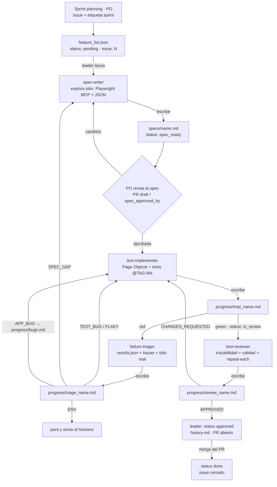

# Flujo de agentes de test

> Cómo se mueve una feature desde "idea en el backlog" hasta "suite verde,
> revisada y trazable". Cada flecha es un subagente lanzado por el `leader`;
> cada caja es un archivo en disco.

## Pipeline

## Scrum ⇄ arnés

| Scrum | En el arnés | Quién |
|-------|-------------|-------|
| Épica | `feature_list.json` → `epic` | PO |
| Historia de usuario | cada feature (`story` + `acceptance`) ↔ un issue de GitHub | PO |
| Sprint backlog | issues con etiqueta `sprint`; la feature guarda `issue: N` | PO en el sprint planning |
| Tareas de la historia | spec → tests → triage → review | leader → subagentes |
| Aprobación de la spec | `spec_approved_by` (PR draft o etiqueta `spec-approved`) | PO |
| Definition of Done | review `APPROVED` + `init.mjs` verde + PR mergeado | reviewer + humano |
| Sprint review / retro | `progress/history.md`, `progress/bugs.md`, loops de `current.md` | equipo |

## Quién toca qué

| Agente | Lee | Escribe | Estado que cambia |
|--------|-----|---------|-------------------|
| `leader` | todo | `progress/current.md`, `history.md`, `feature_list.json` | → `approved` / `blocked` |
| PO (humano) | specs, PRs | `issue`, `spec_approved_by`, merge | planifica · aprueba spec · `approved` → `done` |
| `spec-writer` | backlog, sitio real | `specs/<name>.md` | `pending` → `spec_ready` |
| `test-implementer` | spec, docs, triage/review | `tests/**`, `progress/impl_<name>.md` | → `in_progress` → `in_review` |
| `failure-triager` | spec, impl, `test-results/`, sitio real | `progress/triage_<name>.md`, `progress/bugs.md` | — |
| `test-reviewer` | spec, tests, docs, CHECKPOINTS | `progress/review_<name>.md` | — |

Nadie se autoaprueba: quien escribe la spec no escribe el test, quien escribe
el test no lo aprueba, quien diagnostica no corrige.

## Bucle de corrección

- Cada vuelta `implementer → triager/reviewer → implementer` cuenta como un loop.
- Límite: `rules.max_fix_loops` en `feature_list.json` (por defecto 2).
- Superado el límite → `blocked` con explicación en `progress/current.md`.

## Las puertas objetivas (no dependen de lo que diga un agente)

| Puerta | Dónde se comprueba |
|--------|--------------------|
| Spec con formato válido | `init.mjs` §4 |
| Un test por escenario, sin huérfanos | `init.mjs` §5 |
| Tests compilan y Playwright los descubre | `init.mjs` §6 |
| `approved` / `done` solo con review APPROVED | `init.mjs` §3 |
| No implementar sin spec aprobada por el PO | `init.mjs` §3 |
| WIP: 1 activa, ≤ `max_specs_awaiting_approval` specs en espera | `init.mjs` §3 |
| Estabilidad | `--repeat-each=3` (implementer y reviewer) |
| Feedback inmediato al editar | hook `PostToolUse` → `init.mjs --hook` |
| No cerrar sesión con arnés roto | hook `Stop` → `init.mjs --stop-hook` |

## Cómo arrancarlo

En Claude Code, en la raíz del repo:

> «avanza la siguiente feature del backlog»

o, para una etapa concreta:

> «escribe solo la spec de la feature 5»
